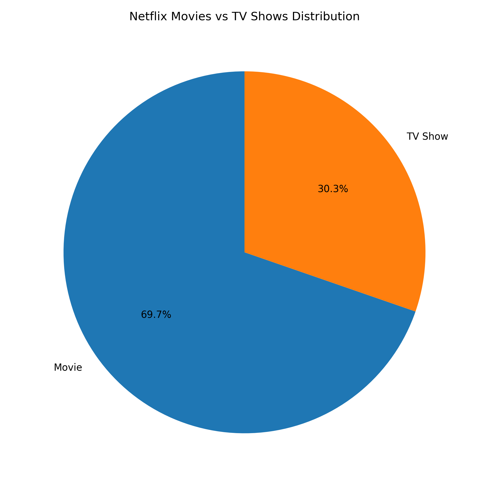
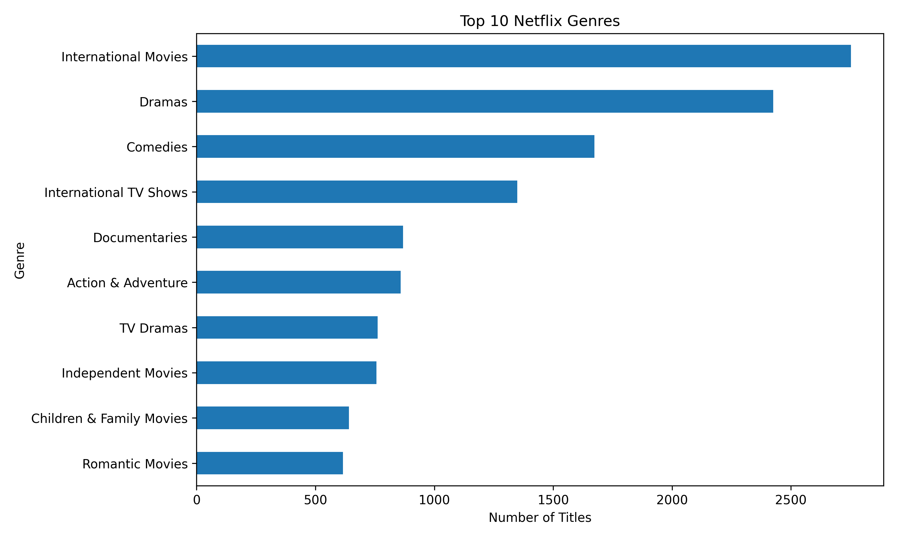
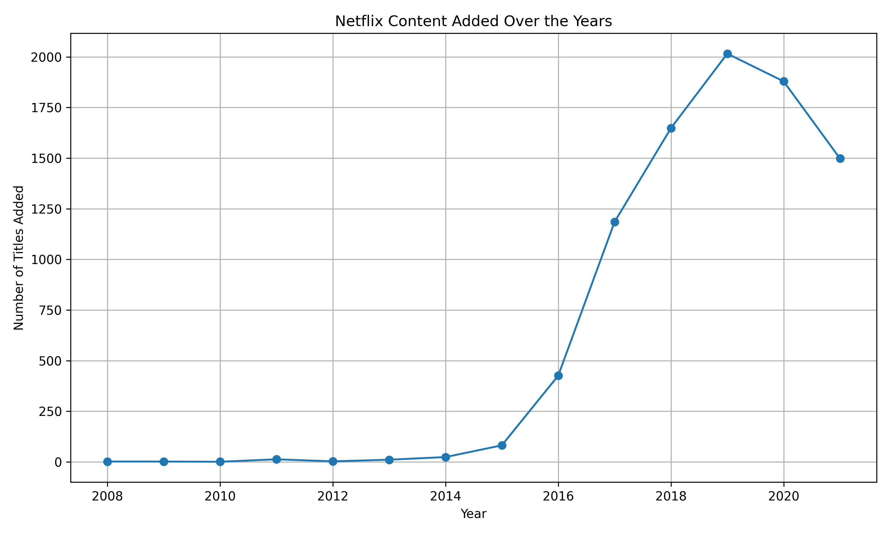
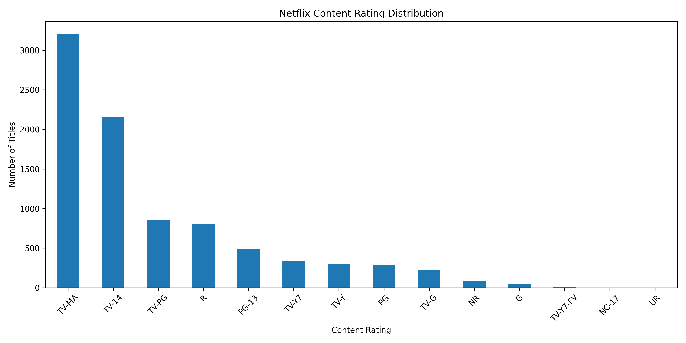
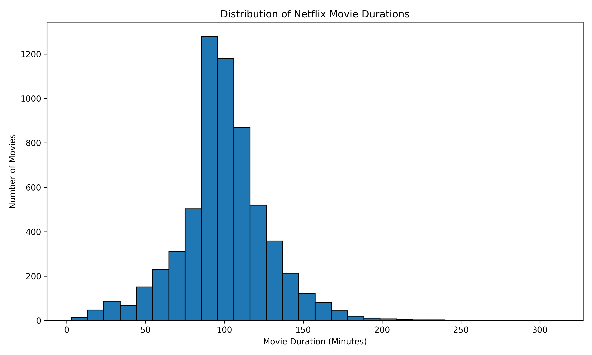
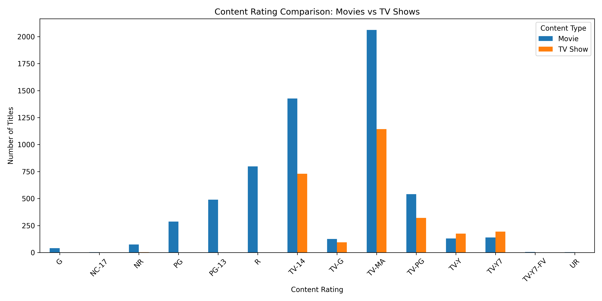

🎬 Netflix Data Analysis Project

📌 Project Overview

This project focuses on exploring and analysing Netflix Movies and TV Shows using Python.

The main objective is to understand Netflix's content library through data cleaning, Exploratory Data Analysis (EDA), statistical analysis, data visualisation, and an interactive Streamlit dashboard.

The project explores patterns and insights related to content types, countries, release years, ratings, genres, movie durations, TV show seasons, and content addition trends.

An interactive dashboard has also been developed using Streamlit, allowing users to explore Netflix content through dynamic filters and visualisations.

🎯 Project Objectives

- Load and understand the Netflix dataset.
- Clean and preprocess the data.
- Identify missing values and duplicate records.
- Analyse Movies and TV Shows.
- Explore country-wise content distribution.
- Analyse release years and Netflix content addition dates.
- Study content ratings and genres.
- Analyse movie durations and TV show seasons.
- Perform statistical and comparative analysis.
- Generate meaningful visualisations.
- Extract useful business insights.
- Develop an interactive dashboard using Streamlit.

🛠️ Technologies Used

- **Python** – Programming language
- **Pandas** – Data manipulation and analysis
- **NumPy** – Numerical operations
- **Matplotlib** – Data visualisation
- **Seaborn** – Statistical data visualisation
- **Streamlit** – Interactive dashboard development
- **VS Code** – Development environment
- **Git and GitHub** – Version control and project hosting

📂 Project Structure

```text
Netflix_Data_Analysis/
│
├── Dataset/
│   └── Dataset.csv
│
├── Visualizations/
│   ├── content_added_yearly.png
│   ├── content_ratings.png
│   ├── content_type_pie.png
│   ├── movie_duration.png
│   ├── rating_comparison.png
│   └── top_10_genres.png
│
├── images/
│   ├── netflix_background.png
│   ├── netflix_banner.png
│   └── netflix_logo.png
│
├── data_cleaning.py
├── data_analysis.py
├── visualizations.py
├── main.py
├── app.py
├── README.md
├── requirements.txt
└── .gitignore
```

Note: The dataset is stored locally and excluded from the GitHub repository because of redistribution and licensing considerations.

📊 Dataset Information

The project uses a Netflix Movies and TV Shows dataset containing:

- **Total Records:** 8,790
- **Total Columns:** 10
- **Movies:** 6,126
- **TV Shows:** 2,664

Dataset Columns

1. show_id
2. type
3. title
4. director
5. country
6. date_added
7. release_year
8. rating
9. duration
10. listed_in

🧹 Data Cleaning and Preprocessing

The following cleaning operations have been performed:

- Inspected dataset dimensions and column information.
- Identified missing values.
- Replaced `"Not Given"` placeholders with missing values.
- Checked duplicate records and duplicate show IDs.
- Standardised content types and ratings.
- Converted `date_added` into datetime format.
- Extracted year and month from the date column.
- Extracted numerical values from the duration column.
- Preserved useful original columns for further analysis.

📈 Exploratory Data Analysis (EDA)

The following analyses have been completed:

1. Content Type Analysis
2. Country-wise Content Analysis
3. Release Year Analysis
4. Content Rating Analysis
5. Genre Analysis
6. Content Added Over Time
7. Movie Duration Analysis
8. TV Show Seasons Analysis

🔬 Advanced Data Analysis

Additional analysis was performed to understand relationships and differences within the Netflix dataset.

- Movies vs TV Shows comparison.
- Release year comparison by content type.
- Content rating percentage comparison.
- Year-wise Netflix content addition comparison.
- Decade-wise release year analysis.
- Movie duration analysis by release decade.
- Correlation analysis of movie release year and duration.

📊 Key Findings and Business Insights

- Netflix contains 6,126 Movies and 2,664 TV Shows.
- Movies represent approximately 69.69% of the dataset, while TV Shows represent 30.31%.
- No duplicate full records or duplicate show IDs were found.
- TV-MA is the most common content rating, with 3,205 titles.
- International Movies is the most frequently listed genre, with 2,752 entries.
- 2019 had the highest number of Netflix content additions, with 2,016 titles.
- July had the highest number of content additions when all available years were combined, with 827 titles.
- The average movie duration is approximately 99.58 minutes.
- The average number of seasons for TV Shows is approximately 1.75.
- Grey's Anatomy has the highest number of seasons in the dataset, with 17.
- The 2010s represent the dominant release decade in the dataset.
- TV-MA content represents a larger share of TV Shows than Movies.

📉 Data Visualisations

The project includes the following visualisations:

1. Content Type Distribution



### 2. Top 10 Netflix Genres



3. Content Added Over the Years



4. Content Rating Distribution



5. Movie Duration Analysis



6. Movie vs TV Show Rating Comparison



🚀 Interactive Streamlit Dashboard

An interactive Netflix Content Analysis Dashboard has been developed using Streamlit.

Dashboard Features

- Netflix-themed background and interface.
- Netflix logo and customised dashboard header.
- Interactive sidebar filters.
- Content type filtering.
- Content rating filtering.
- Release year range filtering.
- Country-based filtering.
- Dynamic content overview cards.
- Top 10 Netflix genres.
- Top 10 countries.
- Movie and TV Show rating comparison.
- Year-wise content addition analysis.
- Movie duration distribution.
- Filtered dataset preview.
- Download filtered data as CSV.

The dashboard updates dynamically based on the selected filters.

⚙️ Installation and Execution

1. Clone the Repository

```bash
git clone https://github.com/balaji-07-cs/Netflix-Data-Analysis.git
```

2. Navigate to the Project Directory

```bash
cd Netflix-Data-Analysis
```

3. Install Required Libraries

```bash
pip install -r requirements.txt
```

4. Add the Dataset

Place the Netflix dataset inside the `Dataset` folder.

The expected file path is:

```text
Dataset/Dataset.csv
```

The dataset is not included in this repository and must be obtained separately.

5. Run the Complete Python Analysis

```bash
python main.py
```

6. Launch the Streamlit Dashboard

```bash
python -m streamlit run app.py
```

The dashboard will open in your default web browser.

📌 Project Progress

- [x] Dataset loading and inspection
- [x] Missing value analysis
- [x] Data cleaning and preprocessing
- [x] Content type analysis
- [x] Country analysis
- [x] Release year analysis
- [x] Content rating analysis
- [x] Genre analysis
- [x] Content added over time analysis
- [x] Movie duration analysis
- [x] TV Show seasons analysis
- [x] Business insights
- [x] Advanced data analysis
- [x] Data visualisations
- [x] Python project organisation
- [x] Streamlit dashboard development
- [x] GitHub repository update
- [x] Project documentation

## 👨‍💻 Author

Balaji B

B.Sc. Computer Science

## 🔗 GitHub Repository

[Netflix Data Analysis Project](https://github.com/balaji-07-cs/Netflix-Data-Analysis)

---

*Developed using Python, Pandas, NumPy, Matplotlib, Seaborn and Streamlit.*